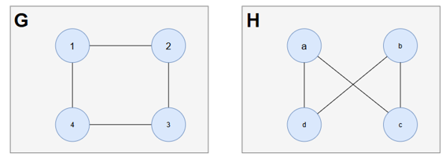
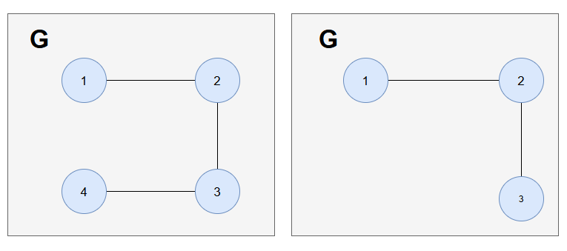
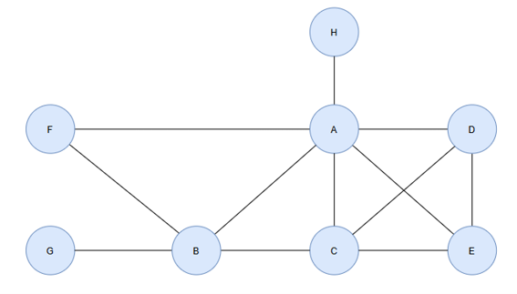

# Material do Estudante – Prática de Grafos

**Disciplina:** Estrutura de Dados II | **Unidade III:** Grafos  
**Professora:** Kadidja Valéria  
**Aluna:** Kamile Dias de Oliveira  

---

## 1. Atividade 1 – Desenhando um grafo

- Considere $V = \{1, 2, 3, 4, 5\}$ e $E = \{(1,2), (1,4), (1,5), (2,3), (3,4), (4,4)\}$. 
- Desenhe o grafo; determine ordem e tamanho; identifique o laço; calcule o grau de cada vértice.
- A aresta $(4,4)$ é um laço. No cálculo do grau, um laço é contado duas vezes.

- **Ordem:** 5 
- **Tamanho:** 6
- **Laço:** $(4,4)$
- **Graus:** $v_1 = 3$, $v_2 = 2$, $v_3 = 2$, $v_4 = 4$, $v_5 = 1$

---

## 2. Atividade 2 – Incidência e adjacência

Utilize o grafo da Atividade 1.  
Liste os vértices adjacentes a cada vértice e as arestas incidentes.  
Escolha dois vértices adjacentes e dois não adjacentes e justifique.

### 1. Vértices Adjacentes a Cada Vértice
- **Vértice 1:** adjacente a 2, 4 e 5.
- **Vértice 2:** adjacente a 1 e 3.
- **Vértice 3:** adjacente a 2 e 4.
- **Vértice 4:** adjacente a 1, 3 e ele mesmo (4) (devido ao laço $(4,4)$).
- **Vértice 5:** adjacente a 1.

### 2. Arestas Incidentes a Cada Vértice
- **Vértice 1:** incidentes às arestas $(1,2)$, $(1,4)$ e $(1,5)$.
- **Vértice 2:** incidentes às arestas $(1,2)$ e $(2,3)$.
- **Vértice 3:** incidentes às arestas $(2,3)$ e $(3,4)$.
- **Vértice 4:** incidentes às arestas $(1,4)$, $(3,4)$ e o laço $(4,4)$.
- **Vértice 5:** incidente à aresta $(1,5)$.

### 3. Escolha e Justificativa de Vértices
- **Vértices adjacentes (1 e 2):**  
  São adjacentes porque existe uma aresta representada por $(1,2)$, que conecta diretamente o vértice 1 ao vértice 2.
- **Vértices não adjacentes (2 e 5):**  
  Não são adjacentes porque não existe nenhuma aresta no conjunto que conecte o vértice 2 diretamente ao vértice 5.

---

## 3. Atividade 3 – Modelagem de uma rede de amizades

Considere João, Carolina, Maria e Marco.  
Defina $V$ e $E$, desenhe a rede, informe se o grafo é dirigido ou não dirigido e justifique.  
Identifique quem possui maior grau no grafo criado.  
Explique o que vértices e arestas representam no problema.

### 1. Definição dos Conjuntos V e E
- $V = \{\text{CAROLINA, MARIA, JOÃO, MARCOS}\}$
- $E = \{(\text{CAROLINA, MARIA}), (\text{MARIA, CAROLINA}), (\text{CAROLINA, JOÃO}), (\text{JOÃO, CAROLINA}), (\text{JOÃO, MARIA}), (\text{MARCOS, JOÃO})\}$

> *Como se trata de um grafo dirigido, cada seta bidirecional representa dois pares ordenados (ida e volta).*

### 2. Classificação do Grafo e Justificativa
- **Tipo de Grafo:** Grafo Dirigido.
- **Justificativa:** O grafo possui setas que indicam a direção das conexões. Em um contexto de rede social (como o Instagram), isso significa que a relação de "seguir" pode ser unilateral (por exemplo, Marcos segue João, mas João não segue Marcos) ou mútua/recíproca (como entre Carolina e Maria, ou Carolina e João).

### 3. Maior Grau
Em grafos dirigidos, calcula-se os graus de entrada (quantas setas chegam) e de saída (quantas setas saem):

$$\text{Grau Total} = \text{Grau Entrada} + \text{Grau Saída}$$

- **CAROLINA:** Chegam 2 setas (de Maria e João) e saem 2 setas (para Maria e João).  
  $$\text{Grau Total} = 2 + 2 = 4$$
- **JOÃO:** Chegam 2 setas (de Carolina e Marcos) e saem 2 setas (para Carolina e Maria).  
  $$\text{Grau Total} = 2 + 2 = 4$$

**Maior Grau:** **CAROLINA** e **JOÃO** possuem o maior grau no grafo criado ($\text{grau} = 4$).

---

## 4. Atividade 4 – Modelagem de ruas de mão única

- Represente cruzamentos/pontos relevantes por vértices e ruas por arestas dirigidas.
- Defina $V$ e $E$ e use setas para indicar o sentido permitido.
- Escolha um vértice e determine seu grau de entrada e grau de saída.
- Explique por que um grafo não dirigido não representa adequadamente a situação.

### 1. Definição dos Conjuntos V e E
- $V = \{A, B, C, D\}$
- $E = \{(A,D), (D,C), (C,B), (B,A)\}$

### 2. Grau de Entrada e Grau de Saída do Vértice A
- **Grau de Entrada:** $1$ (recebe a seta que vem do cruzamento $B$)
- **Grau de Saída:** $1$ (envia a seta que vai para o cruzamento $D$)
- **Grau Total:** $1 + 1 = 2$

### 3. Justificativa
Um grafo não dirigido não representa adequadamente a situação porque suas arestas não possuem direção, o que indicaria que o trânsito é de mão dupla em todas as ruas. Como o problema trata de ruas de mão única, é fundamental utilizar um grafo dirigido (com setas) para definir o sentido permitido e proibir o tráfego no sentido contrário.

## 5. Atividade 5 – Desafio de Isomorfismo

- A professora apresentará dois grafos para comparação:
  - $G: V = \{1,2,3,4\}; E = \{(1,2), (2,3), (3,4), (4,1)\}$
  - $H: V = \{a,b,c,d\}; E = \{(a,c), (c,b), (b,d), (d,a)\}$
- Compare vértices, arestas e graus; procure uma correspondência entre os vértices.
- Verifique se as adjacências são preservadas e registre o mapeamento.
- Conclua, justificadamente, se os grafos são isomorfos.

### 1. Comparação de Vértices, Arestas e Graus
- **Ordem (Vértices):** $|V(G)| = 4$ e $|V(H)| = 4$
- **Tamanho (Arestas):** $|E(G)| = 4$ e $|E(H)| = 4$
- **Graus dos Vértices:**
  - Em $G$: $\text{grau}(1) = \text{grau}(2) = \text{grau}(3) = \text{grau}(4) = 2$
  - Em $H$: $\text{grau}(a) = \text{grau}(b) = \text{grau}(c) = \text{grau}(d) = 2$

### 2. Mapeamento dos Vértices e Preservação de Adjacências
Para mapear o ciclo $1 - 2 - 3 - 4 - 1$ de $G$ no ciclo $a - c - b - d - a$ de $H$, estabelece-se a bijeção $f: V(G) \to V(H)$:

| Vértice em G | Correspondente em H |
| :--- | :--- |
| 1 | a |
| 2 | c |
| 3 | b |
| 4 | d |

**Verificação das Adjacências:**
- $(1,2) \in E(G) \implies (a,c) \in E(H)$ (Preservada)
- $(2,3) \in E(G) \implies (c,b) \in E(H)$ (Preservada)
- $(3,4) \in E(G) \implies (b,d) \in E(H)$ (Preservada)
- $(4,1) \in E(G) \implies (d,a) \in E(H)$ (Preservada)

### 3. Conclusão
Os grafos **$G$ e $H$ são isomorfos**.

**Justificativa:** Ambos os grafos possuem o mesmo número de vértices ($4$), o mesmo número de arestas ($4$), a mesma sequência de graus (todos de grau $2$) e existe uma função bijetora $f$ que preserva exatamente todas as relações de adjacência entre os vértices.

## 6. Atividade 6 – Construindo subgrafos

- A partir do grafo $G$ indicado pela professora, construa dois subgrafos diferentes.
- Para cada um, informe o conjunto de vértices, o conjunto de arestas e faça o desenho.
- Confirme que seus vértices e arestas pertencem ao grafo original.

### 1. Definição do Grafo Original $G$
- **Vértices:** $V(G) = \{1, 2, 3, 4\}$
- **Arestas:** $E(G) = \{(1,2), (2,3), (3,4), (4,1)\}$

---

### 2. Construção dos Subgrafos

#### **Subgrafo $G_1$ (Subgrafo Gerador de 4 vértices)**
Formado mantendo todos os vértices do grafo original e removendo a aresta $(4,1)$:
- **Vértices:** $V(G_1) = \{1, 2, 3, 4\}$
- **Arestas:** $E(G_1) = \{(1,2), (2,3), (3,4)\}$

> **Confirmação:** Todos os vértices de $V(G_1)$ estão em $V(G)$ e o conjunto de arestas $E(G_1) \subset E(G)$.

#### **Subgrafo $G_2$ (Subgrafo Induzido de 3 vértices)**
Formado selecionando os vértices $1, 2$ e $3$ e as arestas presentes entre eles:
- **Vértices:** $V(G_2) = \{1, 2, 3\}$
- **Arestas:** $E(G_2) = \{(1,2), (2,3)\}$

> **Confirmação:** $V(G_2) \subset V(G)$ e todas as arestas de $E(G_2)$ pertencem ao conjunto $E(G)$.

---

### 3. Validação Final
Ambos os subgrafos satisfazem formalmente a definição de subgrafo $H = (V', E')$, onde $V' \subseteq V(G)$ e $E' \subseteq E(G)$, garantindo que todos os vértices e arestas pertencem estritamente ao grafo original $G$.

## 7. Atividade 7 – Desafio da sequência de graus

- Construa um grafo simples de acordo com a sequência de graus indicada pela professora.
- Adicione as arestas progressivamente, calcule o grau de cada vértice e organize os graus em ordem não decrescente.
- Compare a sequência obtida com a sequência solicitada e revise as arestas, se necessário.

**Sequência solicitada:** $(1, 1, 2, 3, 3, 4, 4, 6)$

---

### 1. Vértices e Tabela de Graus Obtidos

**Vértices identificados:** $A, B, C, D, E, F, G, H$

| Vértice | Grau obtido |
| :--- | :---: |
| **A** | 6 |
| **B** | 4 |
| **C** | 4 |
| **D** | 3 |
| **E** | 3 |
| **F** | 2 |
| **G** | 1 |
| **H** | 1 |

---

### 2. Preenchimento das Lacunas da Atividade

* **Conjunto de arestas E:**
  $$E = \{(A,H), (A,F), (A,B), (A,C), (A,D), (A,E), (B,G), (B,F), (B,C), (C,D), (C,E), (D,E)\}$$

* **Sequência obtida:** $(1, 1, 2, 3, 3, 4, 4, 6)$

* **Soma dos graus:** $24$

* **Número de arestas:** $12$

* **Verificação:** soma dos graus $= 2 \times$ número de arestas? 
  **Sim ($24 = 2 \times 12$).**

---

### 3. Conclusão
A sequência obtida é **idêntica** à sequência solicitada $(1, 1, 2, 3, 3, 4, 4, 6)$. O grafo construído é simples (sem laços nem arestas paralelas) e atende plenamente ao Teorema do Aperto de Mãos e a todos os critérios da atividade.