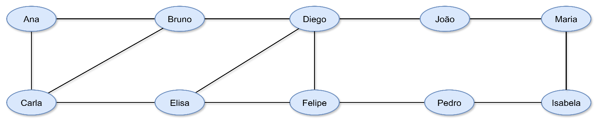

# MINIPROJETO CONECTA UDF

**Disciplina:** Estrutura de Dados II | Unidade III: Grafos
**Professora:** Kadidja Valéria
**Aluna:** Kamile Dias de Oliveira

## Desafio Proposto

* Representar uma rede social como um grafo.
* Calcular conexões e densidade.
* Descobrir caminhos entre usuários.
* Usar Python para automatizar os cálculos.
* **Atividade Prática:** Adicionar 4 usuários fictícios, criar pelo menos 5 novas amizades, atualizar o grafo e o código, e comparar os graus e a densidade antes e depois.

## 1. Grafo Atualizado (Rede Expandida com 10 Usuários)

Abaixo está a representação visual da rede social expandida com os novos usuários (João, Maria, Pedro e Isabela) e as novas conexões:



## 2. Código Python Atualizado

```python
rede = {
    "Ana": ["Bruno", "Carla"],
    "Bruno": ["Ana", "Carla", "Diego"],
    "Carla": ["Ana", "Bruno", "Elisa"],
    "Diego": ["Bruno", "Elisa", "Felipe", "João"],
    "Elisa": ["Carla", "Diego", "Felipe"],
    "Felipe": ["Diego", "Elisa", "Pedro"],
    "João": ["Diego", "Maria"],
    "Pedro": ["Felipe", "Isabela"],
    "Maria": ["João", "Isabela"],
    "Isabela": ["Pedro", "Maria"]
}

n = len(rede)  # n representa o número total de vértices (nós/pessoas) na rede
# rede.values() traz as listas de amigos.
# len(a) calcula o grau (número de amigos) daquela pessoa.
soma_graus = sum(len(a) for a in rede.values())

# E representa o número de arestas (linhas de conexão exclusivas)
E = soma_graus // 2

# D representa a densidade (proporção de conexões reais frente ao máximo teórico possível)
D = 2 * E / (n * (n - 1))

print(f"Vértices: {n} | Arestas: {E} | Densidade: {D:.2%}")
```

## 3. Comparativo: Antes vs. Depois

### ANTES (Rede Original com 6 Usuários)

* **Calcule o Grau:**
  * $\text{Ana} = 2$
  * $\text{Bruno} = 3$
  * $\text{Carla} = 3$
  * $\text{Diego} = 3$
  * $\text{Elisa} = 3$
  * $\text{Felipe} = 3$
  * *Maior grau:* Bruno, Carla, Diego e Elisa.

* **Conte as Arestas:**
  * $\text{Soma} = 2 + 3 + 3 + 3 + 3 + 2 = 16$
  * $\text{Arestas} = 16 \div 2 = 8$
  * $E = 8$ amizades.

* **Calcule a Densidade:**
  * $D = \frac{2E}{V \times (V - 1)}$
  * $E = 8$ | $V = 6$
  * $D = \frac{16}{6 \times 5} = \frac{16}{30}$
  * $D \approx 0,533 = 53,3\%$ das conexões possíveis.

### DEPOIS (Rede Expandida com 10 Usuários)

* **Calcule o Grau:**
  * $\text{Ana} = 2$
  * $\text{Bruno} = 3$
  * $\text{Carla} = 3$
  * $\text{Diego} = 4$
  * $\text{Elisa} = 3$
  * $\text{Felipe} = 3$
  * $\text{João} = 2$
  * $\text{Pedro} = 2$
  * $\text{Maria} = 2$
  * $\text{Isabela} = 2$
  * *Maior grau:* Diego ($4$ conexões).

* **Conte as Arestas:**
  * $\text{Soma} = 2 + 3 + 3 + 4 + 3 + 3 + 2 + 2 + 2 + 2 = 26$
  * $\text{Arestas} = 26 \div 2 = 13$
  * $E = 13$ amizades.

* **Calcule a Densidade:**
  * $D = \frac{2E}{V \times (V - 1)}$
  * $E = 13$ | $V = 10$
  * $D = \frac{26}{10 \times 9} = \frac{26}{90}$
  * $D \approx 0,2888 = 28,88\%$ das conexões possíveis.